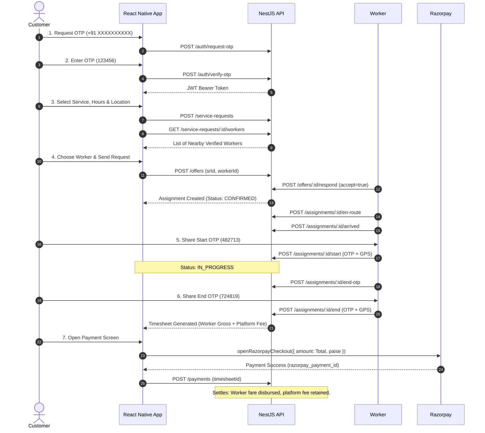

# H-Staff — Comprehensive System Documentation & Integration Guide

**H-Staff** is an on-demand home and facility staffing platform built with a high-performance **NestJS (Node.js/TypeScript) Backend** and an **Android-First React Native Frontend**, integrated with Razorpay Test Mode and Google Cloud Translation.

---

## 1. High-Level Architecture & Project Structure

```
HStaff/
├── src/                          # NestJS Backend API & Services
│   ├── auth/                     # OTP authentication & JWT issuance
│   ├── workers/                  # Worker onboarding, KYC, availability & profiles
│   ├── service-requests/         # Customer booking creation & worker discovery
│   ├── offers/                   # Worker offer lifecycle & distributed redis locks
│   ├── assignments/              # Active job sessions, GPS attendance & OTP verification
│   ├── payments/                 # Razorpay gateway settlement & worker payouts
│   ├── feedback/                 # Star ratings, reviews & dispute/complaint filing
│   ├── events/                   # WebSockets & in-app notifications
│   ├── audit/                    # Compliance & transaction logging
│   └── prisma.service.ts         # PostgreSQL database interface
├── prisma/                       # Database schema & migrations
├── frontend/                     # React Native Android Mobile Application
│   ├── android/                  # Android Studio Native Project (Gradle / Java / NDK)
│   ├── src/
│   │   ├── lib/
│   │   │   ├── api.ts            # Network client with token injection & error mapping
│   │   │   ├── config.ts         # Environment configuration (API, Razorpay, Google Translate)
│   │   │   ├── domain.ts         # Domain models, pricing tier calculator & state machines
│   │   │   ├── razorpay.ts       # Razorpay checkout runner with load handling & fallback
│   │   │   ├── translator.ts     # 10 Indian languages static dictionary & Google Cloud API
│   │   │   └── storage.ts        # AsyncStorage persistence layer
│   │   ├── state/
│   │   │   └── useHStaff.ts      # Core application hook (API-first with mock fallback)
│   │   ├── screens/              # UI screens (Home, Flow, AuthFlow, Misc, Sheets, shared)
│   │   └── components/           # UI elements & micro-animations
│   ├── .env.example              # Public template for environment variables
│   └── .env                      # Local gitignored environment variables
└── README.md                     # This file
```

---

## 2. End-to-End Business Flow



---

## 3. Pricing & Platform Fee Split Logic

The total amount paid by the customer is calculated and split as follows:

1. **Worker Fare (Disbursed to Worker)**:
   $$\text{Fare} = \text{Hourly Rate} \times \text{Hours}$$
   *Example: Sunita Patil charges ₹250/hr $\times$ 1 hr = ₹250.*
2. **Platform Fee (Retained by H-Staff)**:
   - 1 hour: **₹50**
   - 2 hours: **₹100**
   - 3 hours: **₹200**
   - Each additional hour: **+₹100/hr**
3. **Total Customer Bill**:
   $$\text{Total} = \text{Worker Fare} + \text{Platform Fee}$$
   *Example for 1 hour: ₹250 (Worker) + ₹50 (Platform Fee) = ₹300 Total.*
4. **Disbursement**: When payment succeeds via Razorpay, the backend creates a `Payment` record of ₹300 and a `Payout` record of ₹250 directly for the worker.

---

## 4. API Endpoints Specification

### Authentication (`/auth`)
- `POST /auth/request-otp`: Send 6-digit OTP to mobile number (`{ phone }`).
- `POST /auth/verify-otp`: Verify code and receive JWT Bearer token (`{ phone, code, role }`).
- Auth and service start/end codes are delivered by Twilio SMS; OTP values are not returned by the API.

### Service Requests & Booking (`/service-requests`)
- `POST /service-requests`: Create a new booking draft with category, address, hours, notes.
- `GET /service-requests/:id`: Fetch active request details.
- `GET /service-requests/:id/workers`: Discover matching nearby workers within radius.
- `GET /service-requests`: List current customer's requests.

### Offers (`/offers`)
- `POST /offers`: Dispatch an offer to a specific worker (`{ serviceRequestId, workerId }`).
- `GET /offers/worker`: Worker fetches incoming job offers.
- `POST /offers/:id/respond`: Worker accepts or declines with distributed Redis mutex lock (`{ accept: boolean }`).

### Assignments & Attendance (`/assignments`)
- `GET /assignments/:id`: Get active job session details.
- `GET /assignments/mine`: List active/past assignments for current user.
- `POST /assignments/:id/en-route`: Transition to worker en-route.
- `POST /assignments/:id/arrived`: Transition to worker arrived at customer premises.
- `POST /assignments/:id/start-otp`: Issue 6-digit start code to customer.
- `POST /assignments/:id/start`: Verify Start OTP with GPS coordinates (`{ otp, latitude, longitude }`).
- `POST /assignments/:id/end-otp`: Issue 6-digit completion code to customer.
- `POST /assignments/:id/end`: Verify End OTP with GPS, calculates verified hours and creates timesheet.
- `GET /assignments/:id/timesheet`: Retrieve generated timesheet.
- `POST /timesheets/:id/approve`: Customer approves a timesheet within 24 hours of submission.
- `POST /timesheets/:id/dispute`: Customer disputes a timesheet within 24 hours (`{ reason }`). Undisputed pending timesheets auto-approve after 24 hours.
- `GET /admin/timesheets/disputed`: Admin lists timesheets awaiting dispute resolution.
- `PATCH /admin/timesheets/:id/dispute`: Admin resolves with `{ status: "APPROVED" | "REJECTED", resolution }`.

### Payments (`/payments`)
- `POST /payments`: Record customer payment and trigger worker payout (`{ timesheetId, simulateFail? }`).
- `GET /payments/:timesheetId`: Check payment status and fee breakdown.

### Worker Profile (`/workers`)
- `PUT /workers/me/bank-info`: Save payout details (`accountHolderName`, `bankName`, `accountNumber`, `ifscCode`). Account numbers are encrypted at rest and returned only as a masked value from `GET /workers/me`.

### Ratings & Disputes (`/ratings` & `/complaints`)
- `POST /ratings`: Submit star rating, tags, and comments.
- `POST /complaints`: File service dispute (`NO_SHOW`, `POOR_QUALITY`, `OVERCHARGING`, `UNPROFESSIONAL`, `DAMAGED_PROPERTY`, `OTHER`).

### Notifications (`/notifications`)
- `GET /notifications`: Fetch user's notification stream.
- `POST /notifications/:id/read`: Mark notification as read.

---

## 5. Resilient Fallback & Load Handling Architecture

Mobile apps encounter dropped connections, offline mode, and latency spikes. H-Staff implements a **two-tier defense**:

1. **Network Abort & Timeout Defense**:
   - Every fetch request is governed by an `AbortController` set to 12,000ms (`API_CONFIG.TIMEOUT_MS`). Slow 2G/3G connections will not freeze the UI thread.
2. **Graceful Fallback Mode**:
   - Every backend call in [useHStaff.ts](file:///c:/Users/Abhijeet/Desktop/hstaff/HStaff/frontend/src/state/useHStaff.ts) is wrapped in `try/catch`.
   - If the backend is unreachable or undergoing maintenance:
     - Worker discovery falls back to localized demo profiles.
     - OTP verification falls back to built-in demo keys (`482713` Start, `724819` End, `123456` Auth).
     - State transitions continue locally, saving to `AsyncStorage`.
     - Razorpay runs in test simulation (`pay_test_xxxx`) if the native bridge is unavailable.
3. **Multi-Language Offline Fallback**:
   - [translator.ts](file:///c:/Users/Abhijeet/Desktop/hstaff/HStaff/frontend/src/lib/translator.ts) includes a static pre-compiled dictionary for all 10 Indian languages.
   - UI renders instantly without waiting for Google Cloud API responses.
   - Dynamic caching prevents repeated API hits and protects Google API quotas.

---

## 6. How to Run & Test Locally

### Prerequisites
- **Node.js**: `v22.11.0` or higher
- **PostgreSQL**: Local or Docker instance running on port 5432
- **Redis**: Local or Docker instance running on port 6379

### Step 1: Start Backend
```bash
# In the root repository directory (HStaff/)
npm install
npx prisma generate
npx prisma migrate dev
npm run start:dev
```
Set `BANK_INFO_ENCRYPTION_KEY` to a 64-character hexadecimal key before saving bank details. Configure `TWILIO_ACCOUNT_SID`, `TWILIO_AUTH_TOKEN`, and `TWILIO_FROM_NUMBER` for SMS delivery; production startup requires all four values. Keep these in the backend environment and never commit them. Backend will start on `http://localhost:3000`.

### Step 2: Configure Frontend Environment
In `HStaff/frontend/`:
```bash
# Create local .env from example (never commit .env to GitHub)
cp .env.example .env
```
Populate your test keys:
```env
REACT_APP_API_BASE_URL=http://10.0.2.2:3000
RAZORPAY_KEY_ID=rzp_test_YOUR_KEY
GOOGLE_TRANSLATE_API_KEY=AIzaSy_YOUR_KEY
```

### Step 3: Run Frontend in Metro Bundler
```bash
cd frontend
npm install
cmd.exe /c "npm start"
```

---

## 7. How to Open, Build & Run in Android Developer Studio

### 1. Open in Android Studio
1. Launch **Android Studio**.
2. Select **Open** and browse to:
   `c:\Users\Abhijeet\Desktop\hstaff\HStaff\frontend\android` (select the `android` folder, NOT the root).
3. Wait for Android Studio to index and perform **Gradle Sync**.

### 2. Configure SDK & JDK
- Go to **File ➔ Project Structure ➔ SDK Location**:
  - **Gradle JDK**: Set to **Embedded JDK 17** (or Java 17).
  - **SDK Platforms**: Ensure **Android API 36 / 37** is installed.
  - **SDK Tools**: Build-Tools `37.0.0`, NDK `27.1.12297006`.

### 3. Setup Emulator or Real Android Device
- **Emulator**:
  - Open **Device Manager** ➔ Create Device (e.g. Pixel 8) with **API 36/37** ➔ Launch emulator.
  - Android emulator loopback `10.0.2.2` will automatically reach your local NestJS backend at `http://localhost:3000`.
- **Physical Device**:
  - Enable **Developer Options** and **USB Debugging** on your phone.
  - Connect via USB.
  - Run in terminal:
    ```bash
    adb reverse tcp:8081 tcp:8081    # Metro bundler
    adb reverse tcp:3000 tcp:3000    # Backend API
    ```

### 4. Build and Run App
- In Android Studio, ensure the run configuration is set to **app** and click the green **Run (▶)** button.
- Alternatively, run from the command line:
  ```bash
  cd frontend
  npm run android
  ```

---

## 8. Verification & Test Checklist

- [x] **Authentication**: Request OTP and verify with `123456`.
- [x] **Worker Discovery**: Filter by services (Cleaning, Electrical, Plumbing, etc.).
- [x] **Language Switching**: Tap the **Languages icon** in the top navigation bar and select Hindi, Marathi, Gujarati, Tamil, Kannada, Telugu, Malayalam, Punjabi, or Bengali.
- [x] **Live Job Cycle**:
  1. Worker accepts booking.
  2. Worker transitions to `En Route` ➔ `Arrived`.
  3. Start service with Start Code `482713`.
  4. End service with End Code `724819`.
- [x] **Razorpay Payment**:
  1. Review fare split: Worker fare (e.g. ₹250) + Platform fee (e.g. ₹50) = ₹300.
  2. Click **Pay ₹300**.
  3. Verify payment success screen and worker rating review.
  4. Test error handling using the **"Test failure handling"** button.
