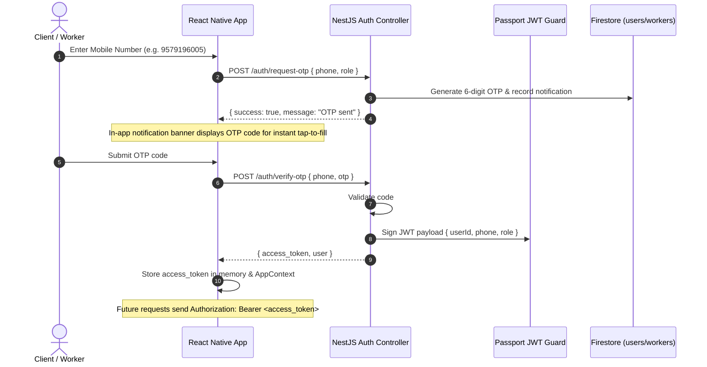
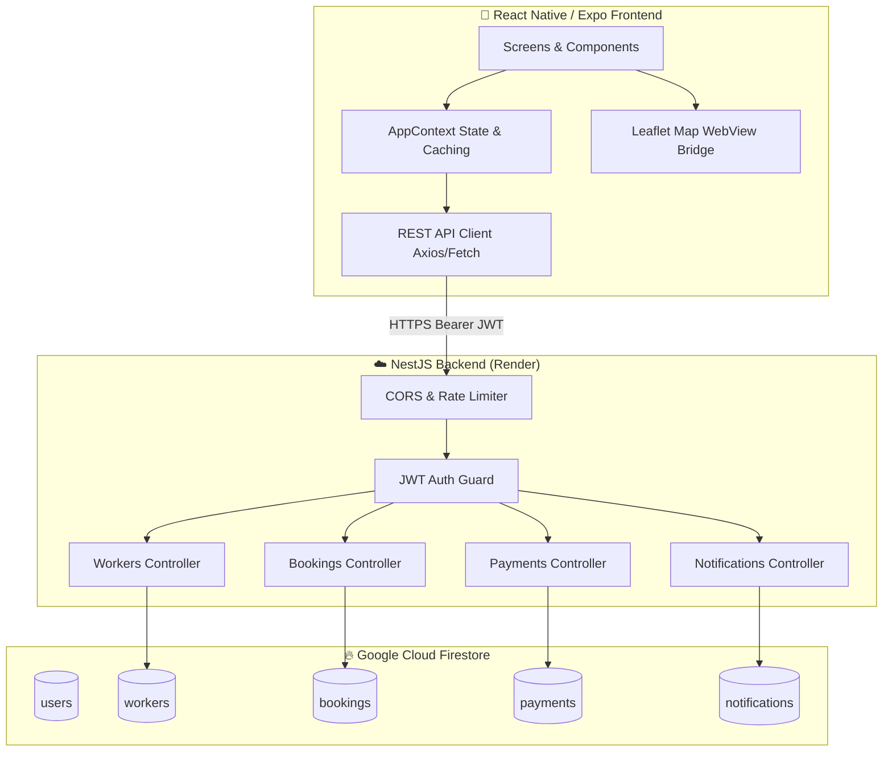
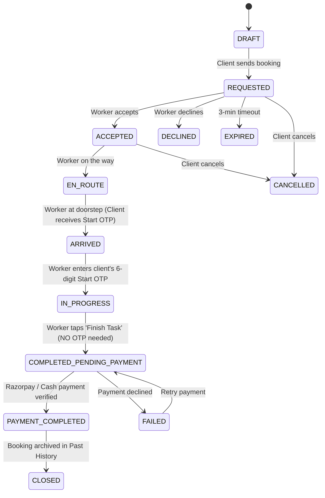

# 🏗️ H-Staff: Tech Stack, Routes, Authentication & Architecture Overview

Comprehensive architectural specification and technical documentation for **H-Staff (Hourly)** — an on-demand domestic staff booking platform connecting clients with verified local helpers (cleaning, cooking, plumbing, electrical, and general help) across Maharashtra, India.

---

## 📑 Table of Contents
1. [Tech Stack Overview](#1-tech-stack-overview)
2. [Complete Route Map (Frontend & Backend)](#2-complete-route-map)
3. [Authentication & Authorization Flow](#3-authentication--authorization-flow)
4. [System Architecture & State Machine](#4-system-architecture--state-machine)
5. [Key Subsystems & Domain Workflows](#5-key-subsystems--domain-workflows)
6. [Database Schema (Firestore)](#6-database-schema-firestore)

---

## 1. Tech Stack Overview

### 📱 Frontend (Mobile Application)
| Technology / Library | Version | Purpose |
| :--- | :--- | :--- |
| **React Native** | `0.86.3` | Cross-platform mobile foundation |
| **Expo SDK** | `57.0.28` | Managed workflow, build tools, native module runtime |
| **TypeScript** | `6.0.3` | Strict type safety across components, context, and DTOs |
| **React** | `19.2.3` | UI state and hook lifecycle |
| **Leaflet & OpenStreetMap** | `1.9.4` (via WebView) | Real interactive maps, custom pins, GPS routing without Google Maps billing dependencies |
| **Nominatim API** | OpenStreetMap | Doorstep address search and reverse geocoding |
| **React Native WebView** | `13.16.1` | Bridge Leaflet interactive HTML maps and Razorpay web checkout |
| **Expo Location** | `57.0.21` | Native device GPS coordinates capture |
| **Expo LinearGradient** | `57.0.2` | Signature brand gradient buttons & cards (`['#FF9C7A', '#E96B9A']`) |
| **Expo ImagePicker** | `57.0.20` | Worker avatar and profile document uploads |
| **Expo Vector Icons** | `15.0.2` | Ionicons & MaterialIcons design iconography |
| **Safe Area Context** | `5.7.0` | Edge-to-edge layout management for notch and gesture bars |
| **EAS CLI** | `24.14.0` | Cloud & local Android standalone APK compilation |

### 🖥️ Backend (REST API Service)
| Technology / Library | Version | Purpose |
| :--- | :--- | :--- |
| **NestJS** | `11.0.0` | Modular, enterprise TypeScript server framework |
| **Node.js** | `v22.x` (LTS) | High-performance asynchronous backend runtime |
| **Google Cloud Firestore** | `13.1.0` (Admin SDK) | NoSQL document database for users, workers, bookings, payments |
| **Resilient Local DB** | Custom In-Memory | Zero-crash fallback ensuring development and tests never break |
| **Passport & JWT** | `0.7.0` / `11.0.0` | Stateless token validation and user identity extraction |
| **Class Validator & Transformer**| `0.14.1` / `0.5.1` | Declarative request payload sanitization and DTO validation |
| **Cloud Hosting** | Render | Live high-availability deployment (`https://hourly-fxya.onrender.com/api/v1`) |

### 💳 Payment & Gateway Integration
- **Razorpay Payment Gateway**: Authentic Indian payment infrastructure (UPI Apps, QR, RuPay/Visa/Mastercard, NetBanking with 50+ Indian banks).
- **Cash on Delivery (COD)**: Doorstep cash settlement recorded and confirmed directly by worker and client.

---

## 2. Complete Route Map

### 📱 Frontend Screen Routes (`ScreenRoute`)

The mobile client utilizes an explicit state-driven navigation router (`src/app/index.tsx`) backed by a history stack (`routeStack`).

```
[Splash Screen]
       │
       ▼
[Welcome Screen] (Select Role: 'client' | 'worker')
       │
       ▼
[Auth Phone Screen] ──▶ [Auth OTP Screen] ──▶ [Signup Screen]
                                                     │
               ┌─────────────────────────────────────┴─────────────────────────────────────┐
               ▼                                                                           ▼
      [Client Interface]                                                          [Worker Dashboard]
               │                                                                           │
  ┌────────────┼────────────┬─────────────┐                                   ┌────────────┼─────────────┐
  ▼            ▼            ▼             ▼                                   ▼            ▼             ▼
[Home]     [Discover]  [Bookings]     [Profile]                          [Incoming]   [Active Job]   [Earnings]
  │                                                                           │            │
  ▼ (Dispatch Flow)                                                           ▼            ▼
[Booking Mode (Instant/Sched)]                                            [Accept]    [Enter Start OTP]
  │                                                                                        │
  ▼                                                                                        ▼
[Requirements (Hours/Task)]                                                           [Finish Task]
  │                                                                                        │
  ▼                                                                                        ▼
[Materials (Client/Worker)]                                                            [Payment]
  │
  ▼
[Location (GPS & Leaflet)]
  │
  ▼
[Professionals Match (Distance km)]
  │
  ▼
[Pro Profile]
  │
  ▼
[Summary (Upfront Total)] ──▶ [Service Status (Live Tracker)] ──▶ [Payment Screen] ──▶ [Complete]
```

#### Detailed Frontend Screen Registry

| Route Key | Screen Component | Target Audience | Primary Function & Actions |
| :--- | :--- | :--- | :--- |
| `splash` | `SplashScreen.tsx` | All Users | Verifies session token; redirects to `home` if authenticated or `welcome` if unauthenticated. |
| `welcome` | `WelcomeScreen.tsx` | New Guests | Brand showcase card (GPS matching, ID verification, upfront pricing) with Client / Worker signup options. |
| `auth_phone` | `AuthPhoneScreen.tsx` | Guests | 10-digit mobile number entry; requests OTP from backend. |
| `auth_otp` | `AuthOtpScreen.tsx` | Guests | 6-digit OTP verification; auto-fill from notification tray; JWT token assignment. |
| `signup` | `SignupScreen.tsx` | New Users | Role-specific profile completion (doorstep address for client; trade skills/rate/photo for worker). |
| `home` | `HomeScreen.tsx` | Client | Active booking banner, quick categories, nearby verified workers list, city switcher modal. |
| `home` | `WorkerDashboardScreen.tsx`| Worker | Dedicated worker dashboard: incoming job requests, live task execution, OTP verification, daily earnings. |
| `discover` | `DiscoverScreen.tsx` | Client | Complete 15-category domestic staff directory with category filters. |
| `bookings` | `BookingsScreen.tsx` | Client | **Upcoming** (ongoing jobs) vs. **Past** (completed & paid jobs) partitioned history with pull-to-refresh. |
| `profile` | `ProfileScreen.tsx` | All Users | User profile details, GPS address view, role switching, app version, and logout. |
| `notifications`| `NotificationsScreen.tsx`| All Users | Real-time notification log (OTPs, request alerts, payment receipts) with mark-as-read. |
| `booking_mode` | `ModeScreen.tsx` | Client | Step 1: Instant dispatch (~30 min arrival) vs. Scheduled service date & time. |
| `booking_requirements`| `RequirementsScreen.tsx`| Client | Step 2: Duration counter (1–8 hrs) & specific task requirement description. |
| `booking_materials`| `MaterialsScreen.tsx`| Client | Step 3: Material selection ("I'll provide materials" vs. "Worker brings materials"). |
| `booking_location`| `LocationScreen.tsx`| Client | Step 4: Live Leaflet map, automated GPS detection, doorstep/flat text input. |
| `booking_professionals`| `ProfessionalsScreen.tsx`| Client | Step 5a: Worker card catalog displaying distance in km, completed jobs count, and rate. |
| `booking_pro_profile`| `ProfessionalProfileScreen.tsx`| Client | Step 5b: Extended worker bio, equipment list, languages spoken, verified badge. |
| `booking_summary`| `SummaryScreen.tsx`| Client | Step 5c: Upfront price breakdown (`Client Rate x Hours`), address confirmation, "Send service request". |
| `service_status`| `ServiceStatusScreen.tsx`| Client | Real-time progress monitor (REQUESTED -> ACCEPTED -> ARRIVED -> IN_PROGRESS). Shows Start OTP. |
| `payment` | `PaymentScreen.tsx` | Client | Settlement screen: Razorpay Modal (UPI, Cards, NetBanking) or Doorstep Cash (COD). |
| `complete` | `CompleteScreen.tsx` | Client | Official digital service receipt with amount paid, transaction ID, and booking reference. |

---

### 🌐 Backend API Endpoints

Base URL: `https://hourly-fxya.onrender.com/api/v1`

#### 1. Authentication Module (`/auth`)
| Method | Endpoint | Auth Required | Description | Request Body |
| :--- | :--- | :--- | :--- | :--- |
| `POST` | `/auth/request-otp` | ❌ Public | Sends 6-digit OTP to mobile and user notification stream | `{ "phone": "9579196005", "role": "client" \| "worker" }` |
| `POST` | `/auth/verify-otp` | ❌ Public | Verifies OTP and returns JWT Bearer token + user document | `{ "phone": "9579196005", "otp": "123456" }` |
| `POST` | `/auth/signup` | ✅ JWT Bearer | Creates or updates client/worker profile in Firestore | `{ "name": "...", "role": "...", "city": "...", ... }` |
| `PATCH`| `/auth/profile` | ✅ JWT Bearer | Updates existing user profile fields | `{ "city": "Pune", "address": "..." }` |
| `GET` | `/auth/me` | ✅ JWT Bearer | Retrieves currently authenticated user session | *None* |

#### 2. Workers Module (`/workers`)
| Method | Endpoint | Auth Required | Description |
| :--- | :--- | :--- | :--- |
| `GET` | `/workers` | ❌ Public | Retrieves verified workers filtered by `service`, `city`, and `sort`. Dynamically enriches live completed jobs count. |
| `GET` | `/workers/:id` | ❌ Public | Retrieves specific worker profile with bio, skills, rate, and verified badge. |

#### 3. Services Catalog (`/services`)
| Method | Endpoint | Auth Required | Description |
| :--- | :--- | :--- | :--- |
| `GET` | `/services` | ❌ Public | Returns complete domestic staff service catalog (15 services). |
| `GET` | `/services/:name`| ❌ Public | Returns single service details by slug/name. |

#### 4. Bookings Lifecycle Module (`/bookings`)
| Method | Endpoint | Auth Required | Description |
| :--- | :--- | :--- | :--- |
| `POST` | `/bookings` | ✅ JWT Bearer | Creates a new booking request. Generates `startOtp` and `endOtp`, calculates upfront prices, and notifies both parties. |
| `GET` | `/bookings` | ✅ JWT Bearer | Lists bookings relevant to caller. Workers only receive requests assigned to them; clients receive their own bookings. |
| `GET` | `/bookings/:id` | ✅ JWT Bearer | Fetches booking by reference ID. |
| `PATCH`| `/bookings/:id/status`| ✅ JWT Bearer | Transitions booking status (e.g. `ACCEPTED`, `ARRIVED`, `COMPLETED_PENDING_PAYMENT`). |
| `POST` | `/bookings/:id/start-otp` | ✅ JWT Bearer | **Strict Start OTP Verification:** Worker submits 6-digit OTP displayed on client device to start work. |
| `POST` | `/bookings/:id/end-otp` | ✅ JWT Bearer | Verifies optional end OTP. |
| `POST` | `/bookings/:id/cancel` | ✅ JWT Bearer | Cancels booking and notifies opposite party. |

#### 5. Payments Module (`/payments`)
| Method | Endpoint | Auth Required | Description |
| :--- | :--- | :--- | :--- |
| `POST` | `/payments/process` | ✅ JWT Bearer | Records Razorpay / Cash payment settlement. Transitions booking to `PAYMENT_COMPLETED`, increments worker's completed jobs tally, and sends payment receipts. |
| `GET` | `/payments/booking/:id` | ✅ JWT Bearer | Fetches payment record for a booking. |

#### 6. Notifications Module (`/notifications`)
| Method | Endpoint | Auth Required | Description |
| :--- | :--- | :--- | :--- |
| `GET` | `/notifications` | ✅ JWT Bearer | Lists user's in-app notification feed. |
| `PATCH`| `/notifications/:id/read` | ✅ JWT Bearer | Marks a notification as read. |
| `POST` | `/notifications/mark-all-read` | ✅ JWT Bearer | Clears unread badge count for all notifications. |

---

## 3. Authentication & Authorization Flow



### Role Isolation
1. **Client Isolation**:
   - Access to full consumer booking funnels, search catalogs, interactive Leaflet maps, and payment gateways.
2. **Worker Isolation**:
   - When a user logs in with `role === 'worker'`, **consumer catalogs, worker cards, and category exploration screens are completely hidden**.
   - Instead, the app directly mounts [`WorkerDashboardScreen.tsx`](file:///e:/hstaff/react-native/Hourly/src/screens/worker/WorkerDashboardScreen.tsx), which displays only:
     - Real-time incoming job requests with client distance and address.
     - Accept / Decline actions.
     - Strict Start OTP verification input for starting work.
     - Single-tap task finish button.
     - Real-time earnings tally calculated from completed tasks.

---

## 4. System Architecture & State Machine

### High-Level Architecture Diagram



### The 17-State Booking Lifecycle Engine



---

## 5. Key Subsystems & Domain Workflows

### 1. Accurate Live Worker Completed Jobs Count
* **Problem Solved**: Workers had completed multiple tasks, but the client saw `0 jobs completed`.
* **Solution**: In [`workers.service.ts`](file:///e:/hstaff/backend/hourly/src/modules/workers/workers.service.ts), `findAll` and `findByWorkerId` dynamically compute the completed jobs tally from the `bookings` collection (`b.status === 'COMPLETED' || 'PAYMENT_COMPLETED' || 'CLOSED'`). Whenever payment completes in [`payments.service.ts`](file:///e:/hstaff/backend/hourly/src/modules/payments/payments.service.ts), the worker document count is permanently updated in Firestore.

### 2. Upfront Pricing Structure
* **Client Pricing**: `(Worker Hourly Rate + ₹40/hr Platform Margin) * Hours`
* **Worker Payout**: `Worker Hourly Rate * Hours`
* **Transparency**: Both breakdown and hourly rates are visible prior to requesting service. Zero surge pricing.

### 3. Strict Arrival OTP & Zero-Review Workflow
* **Start OTP**: Generated when worker reaches status `ARRIVED`. Sent strictly to client notification tray and screen. The worker must enter this 6-digit code on their dashboard to start the timer.
* **Single-Tap Finish**: Worker simply taps "Finish Task" once work is done. No end OTP is required from the client.
* **Zero Star Ratings**: The entire star review/rating system was removed from client and worker workflows. Staff performance is measured by completed jobs count and verified status.

### 4. Interactive Leaflet Maps & Haversine Distance
* Avoids costly Google Maps billing APIs.
* Uses lightweight Leaflet 1.9.4 rendered inside a native WebView with custom HTML markers.
* Calculates actual geographical distance between client and worker using the **Haversine Formula**:
  $$d = 2R \cdot \arcsin\left(\sqrt{\sin^2\left(\frac{\Delta \phi}{2}\right) + \cos(\phi_1)\cos(\phi_2)\sin^2\left(\frac{\Delta \lambda}{2}\right)}\right)$$
* Displayed dynamically on every worker card: `1.8 km away · ~8 mins`.

---

## 6. Database Schema (Firestore)

### Collection: `users`
```json
{
  "id": "9579196005",
  "phone": "9579196005",
  "name": "Ramesh Patil",
  "role": "worker",
  "city": "Pune",
  "address": "FC Road, Shivajinagar, Pune",
  "latitude": 18.5314,
  "longitude": 73.8446,
  "serviceCategory": "Cleaning",
  "ratePerHour": 250,
  "years": 4,
  "isProfileComplete": true,
  "createdAt": "2026-10-15T10:00:00.000Z"
}
```

### Collection: `workers`
```json
{
  "id": "9579196005",
  "workerId": "9579196005",
  "name": "Ramesh Patil",
  "phone": "9579196005",
  "serviceCategory": "Cleaning",
  "skills": ["Home cleaning", "Deep kitchen cleaning"],
  "ratePerHour": 250,
  "city": "Pune",
  "address": "FC Road, Shivajinagar, Pune",
  "latitude": 18.5314,
  "longitude": 73.8446,
  "jobs": 142,
  "isVerified": true,
  "imageUrl": "https://..."
}
```

### Collection: `bookings`
```json
{
  "id": "BK-MV9BIDMA-4202",
  "bookingId": "BK-MV9BIDMA-4202",
  "clientId": "9403188024",
  "clientName": "Shreyash Ruke",
  "clientPhone": "9403188024",
  "workerId": "9579196005",
  "workerName": "Ramesh Patil",
  "service": "Cleaning",
  "mode": "INSTANT",
  "date": "2026-10-15",
  "time": "02:00 PM",
  "hours": 2,
  "task": "Deep Kitchen Cleaning",
  "address": "Flat 67, Kalyani Nagar, Pune",
  "latitude": 18.5482,
  "longitude": 73.9025,
  "status": "PAYMENT_COMPLETED",
  "workerRate": 250,
  "clientRate": 290,
  "workerPayout": 500,
  "totalAmount": 580,
  "startOtp": "752042",
  "endOtp": "418920",
  "paymentMethod": "Razorpay (UPI)",
  "createdAt": "2026-10-15T10:45:00.000Z"
}
```

### Collection: `payments`
```json
{
  "id": "PAY_1792055392307",
  "paymentId": "PAY_1792055392307",
  "bookingId": "BK-MV9BIDMA-4202",
  "amount": 580,
  "status": "SUCCEEDED",
  "gateway": "RAZORPAY",
  "gatewayReference": "pay_simulated_1792055392307",
  "razorpayPaymentId": "pay_simulated_1792055392307",
  "createdAt": "2026-10-15T11:00:00.000Z"
}
```
